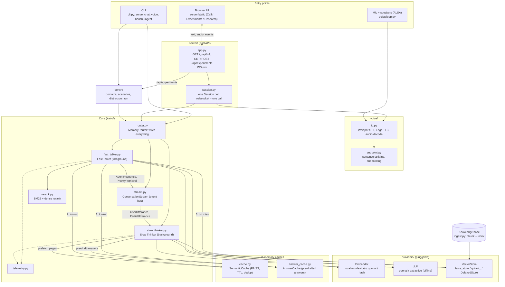
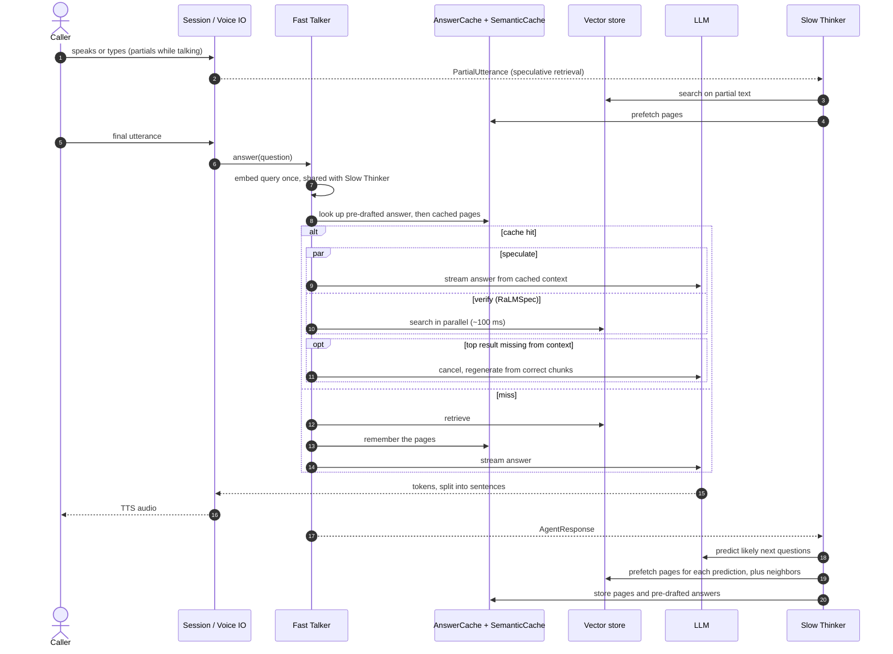

# Kairo Architecture

Kairo is a speculative-RAG voice agent. A foreground agent (**Fast Talker**) answers the caller from an in-memory cache; a background agent (**Slow Thinker**) predicts the next questions and fills that cache ahead of time.

## System overview

## One turn, step by step

## Components

| Layer | Files | Role |
|---|---|---|
| Entry | `cli.py`, `server/app.py`, `voice/loop.py` | CLI commands, web server, local mic loop |
| Session | `server/session.py` | One per websocket; owns a router, streams audio and events to the UI |
| Voice | `voice/io.py`, `voice/endpoint.py` | STT (Whisper), TTS (Edge), audio decoding, sentence splitting |
| Orchestration | `router.py`, `stream.py`, `events.py` | Builds the agents and caches; event bus carries `UserUtterance`, `PartialUtterance`, `AgentResponse`, `PriorityRetrieval` |
| Foreground | `fast_talker.py` | Cache-first answer, speculate-then-verify, fallback to the store |
| Background | `slow_thinker.py` | Predict next questions, prefetch pages and neighbors, pre-draft answers |
| Memory | `cache.py`, `answer_cache.py`, `rerank.py` | FAISS semantic cache, answer cache, BM25 + dense rerank |
| Providers | `providers/*` | Swappable embedder, LLM and vector store behind `base.py` interfaces; `fake.py` gives offline stand-ins |
| Data | `ingest.py`, `bench/*` | Chunk and index documents; benchmark profiles, domains and scenarios |
| UI | `server/static/*`, `web/` | Call, Experiments and Research tabs |

## Design notes

- **Embed once.** The router computes the query embedding once and shares it between agents.
- **Verify off the critical path.** The store search (~100 ms) finishes before the LLM's first token (~1 s), so verification costs no extra latency.
- **Pluggable providers.** Everything runs offline with `hash` embeddings and the `extractive` LLM, which is what the free benchmarks use.
